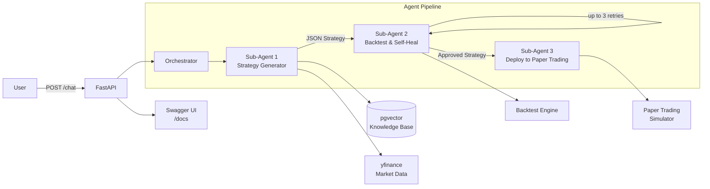

# AlphaAgent

Autonomous agentic investment platform. Type a plain English investment idea, and three AI sub-agents collaborate to **generate**, **backtest**, and **deploy** a trading strategy — all autonomously.

> **Disclaimer:** This is a portfolio/demo project. Not financial advice. Paper trading only.

## Architecture



### What Each Sub-Agent Does

| Sub-Agent | Job | Tools Used |
|-----------|-----|------------|
| **1 — Strategy Generator** | Takes user's natural language input, searches knowledge base via RAG, fetches market data, produces a JSON strategy | `search_knowledge_base`, `fetch_market_data` |
| **2 — Backtest & Self-Heal** | Runs the strategy through a plain-Python backtest engine, evaluates against thresholds (Sharpe > 0.5, drawdown < 25%, win rate > 40%). If it fails, diagnoses the issue, tweaks parameters, and retries (max 3 attempts) | `run_backtest`, `evaluate_results` |
| **3 — Deploy to Paper Trading** | Starts a simulated paper trade that polls live prices and executes the strategy in real-time | `deploy_strategy` |

### Provider-Agnostic LLM Layer

The system uses an abstract base class (`LLMProvider`) with `complete()` and `function_call()` methods. Two implementations:

- **AnthropicProvider** — uses Claude claude-sonnet-4-20250514 with native function calling
- **OpenAIProvider** — uses GPT-4o as a drop-in replacement

Switch between them with a single env var: `LLM_PROVIDER=anthropic` or `LLM_PROVIDER=openai`.

## Quick Start

### 1. Clone and configure

```bash
cp .env.example .env
# Edit .env and add your API keys:
#   ANTHROPIC_API_KEY=sk-ant-...
#   OPENAI_API_KEY=sk-...  (required for embeddings)
```

### 2. Run

```bash
docker compose up --build
```

### 3. Open Swagger UI

Navigate to [http://localhost:8000/docs](http://localhost:8000/docs)

## Example Prompts

Paste these into the `/api/v1/chat` endpoint in Swagger:

### 1. Simple Moving Average Crossover
```json
{"message": "Build me a simple moving average crossover strategy for AAPL"}
```

### 2. Multi-Asset Momentum
```json
{"message": "Create a momentum strategy for MSFT with a 6-month lookback"}
```

### 3. Mean Reversion with RSI
```json
{"message": "Build a mean reversion strategy for SPY that uses RSI"}
```

## What Happens When You Send a Prompt

1. **Orchestrator** receives your message and starts the 3-agent pipeline
2. **Sub-Agent 1** (Strategy Generator):
   - Searches the RAG knowledge base for relevant strategy patterns
   - Fetches historical price data from yfinance
   - Uses the LLM with function calling to design a strategy
   - Outputs a JSON strategy: asset, indicator, entry/exit rules, stop loss
3. **Sub-Agent 2** (Backtest & Self-Heal):
   - Runs the strategy through the backtest engine (plain Python loops over price data)
   - Evaluates: Sharpe ratio, max drawdown, win rate
   - If thresholds fail → LLM diagnoses the issue → tweaks parameters → re-runs
   - Max 3 self-heal attempts, returns the best version
4. **Sub-Agent 3** (Deploy to Paper Trading):
   - Starts a background thread that polls live prices
   - Tracks positions, PnL, and order history
   - Accessible via `GET /strategies/{id}/live`

Every step is logged to the database and printed to console, so you can see the full reasoning chain in real-time.

## Paper Lab — extract, audit and replicate research papers

`app/paper_lab/` turns an investment research paper (PDF) into a machine-checkable spec,
audits it, and replicates its results with public data, so you can decide whether it's worth
building a model on.

```
paper.pdf ─► text ─► PaperInsights (LLM or offline heuristics)
                       ├─ claims, numeric results (every table cell / quantitative sentence)
                       ├─ methodology spec, datasets (+ public substitutes), exhibits
                       └─ replication plan, trading ideas, open questions
          ─► legitimacy checks
                       ├─ internal consistency: spreads, ratios, wealth multiples,
                       │  sub-periods compounding to full period, year counts
                       ├─ citations: in-text vs reference list
                       └─ methodology red flags: costs, significance, OOS, data access, ...
          ─► replication recipe (public data) ─► paper vs replicated, check by check
          ─► report.md + insights.json + legitimacy.json + replication/*.csv
```

```bash
# Full LLM extraction (uses LLM_PROVIDER / ANTHROPIC_API_KEY like the rest of the app)
python -m app.paper_lab analyze paper.pdf --out reports/my_paper

# No API key: heuristic extraction + citation and red-flag checks
python -m app.paper_lab analyze paper.pdf --no-llm --out reports/my_paper

# Replicate with Ken French data (downloads + caches in ~/.cache/paper_lab)
python -m app.paper_lab analyze paper.pdf \
    --insights examples/papers/mcquarrie_2025/insights.json \
    --replicate factor-fluctuation --with-funds --out reports/mcquarrie

python -m app.paper_lab recipes      # list replication recipes
```

API: `POST /api/v1/papers/analyze` (multipart: `file`, `use_llm`, `replicate`, `insights_json`)
and `GET /api/v1/papers/recipes`.

Worked example: [`examples/papers/mcquarrie_2025/`](examples/papers/mcquarrie_2025/report.md) —
McQuarrie (2025), *Do Factor Strategies Beat the Market?* The checks flag that the
Exhibit 3 sub-period returns do not compound to the full-period figures (e.g. small stocks
1982-2023: 11.50% reported vs 10.87% implied by its own sub-periods), a Shumway 1994/1997
citation mismatch, no significance tests, and spliced index/fund data.

To add a recipe for a new paper, write `app/paper_lab/replication/recipes/<name>.py` with a
`run(insights=..., data=..., **kw) -> ReplicationResult` and register it in
`app/paper_lab/replication/__init__.py`.

## API Endpoints

| Method | Path | Description |
|--------|------|-------------|
| `POST` | `/api/v1/chat` | Main endpoint — send a message, agents do everything |
| `GET` | `/api/v1/strategies` | List all generated strategies |
| `GET` | `/api/v1/strategies/{id}` | Strategy detail + backtest history + agent log |
| `GET` | `/api/v1/strategies/{id}/live` | Paper trading status |
| `POST` | `/api/v1/rag/ingest` | Add a document to the knowledge base |
| `POST` | `/api/v1/rag/query` | Standalone RAG search |
| `GET` | `/api/v1/metrics` | LLM usage, latency, tool call stats |
| `POST` | `/api/v1/papers/analyze` | Paper Lab: extract insights, legitimacy checks, optional replication |
| `GET` | `/api/v1/papers/recipes` | Paper Lab replication recipes |
| `GET` | `/api/v1/health` | Health check |

## Project Structure

```
├── docker-compose.yml          # PostgreSQL + pgvector + app
├── Dockerfile
├── requirements.txt
├── .env.example
├── seed_data/                  # 5 markdown docs for RAG seeding
├── prompts/                    # Versioned prompt templates
│   ├── strategy_gen.txt
│   ├── backtest_eval.txt
│   └── self_heal.txt
├── app/
│   ├── main.py                 # FastAPI app + startup (seed RAG on boot)
│   ├── routes/
│   │   ├── chat.py
│   │   ├── strategies.py
│   │   ├── rag.py
│   │   └── metrics.py
│   ├── agents/
│   │   ├── orchestrator.py     # Runs sub-agents 1 → 2 → 3
│   │   ├── strategy_agent.py   # Sub-Agent 1
│   │   ├── backtest_agent.py   # Sub-Agent 2
│   │   └── deploy_agent.py     # Sub-Agent 3
│   ├── core/
│   │   ├── llm.py              # Provider-agnostic LLM abstraction
│   │   ├── rag.py              # Embed, store, retrieve
│   │   ├── backtest.py         # Simple backtest engine
│   │   ├── paper_trade.py      # Simulated paper trading
│   │   └── tools.py            # Function-calling tool definitions
│   ├── db/
│   │   ├── database.py         # SQLAlchemy + pgvector setup
│   │   └── models.py           # Strategy, BacktestResult, PaperTrade, etc.
│   └── observability/
│       └── logger.py           # Structured logging for LLM calls and agent decisions
└── tests/
    ├── test_backtest.py
    ├── test_rag.py
    ├── test_llm.py
    └── test_agent_flow.py
```

## Running Tests

```bash
# Inside the container
docker compose exec app pytest tests/ -v

# Or locally (requires dependencies)
pytest tests/ -v
```

## Observability

Every LLM call logs: provider, model, prompt/completion tokens, latency, tool called. Every agent decision logs: what it decided and why. All stored in PostgreSQL and accessible via `GET /api/v1/metrics`.

Console output shows the full reasoning chain in real-time during a demo.

## Tech Stack

- **Python 3.12** + **FastAPI** with auto-generated Swagger docs
- **PostgreSQL + pgvector** for vector storage
- **Anthropic Claude** (claude-sonnet-4-20250514) with function calling
- **OpenAI** as swappable fallback + text-embedding-3-small for embeddings
- **yfinance** for market data
- **Docker Compose** — one command to run everything
- **pytest** for testing
